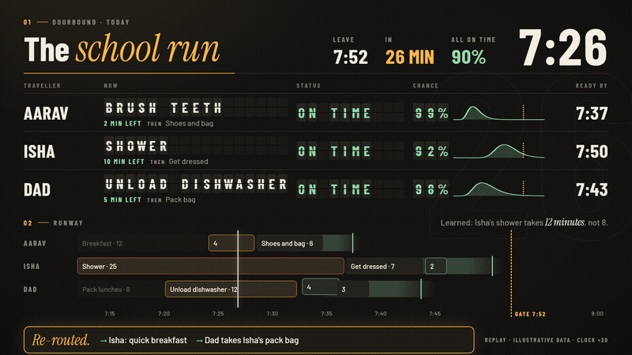
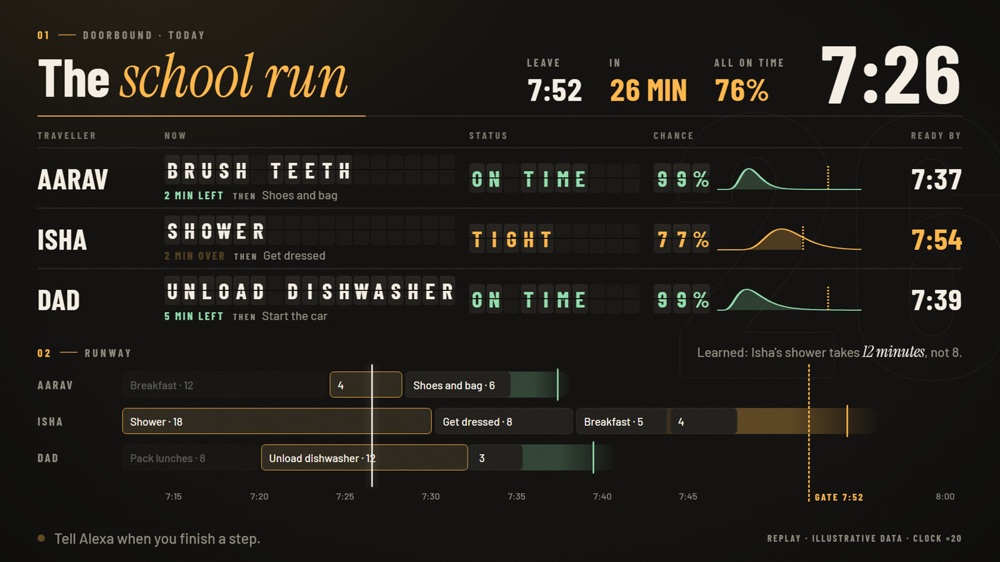
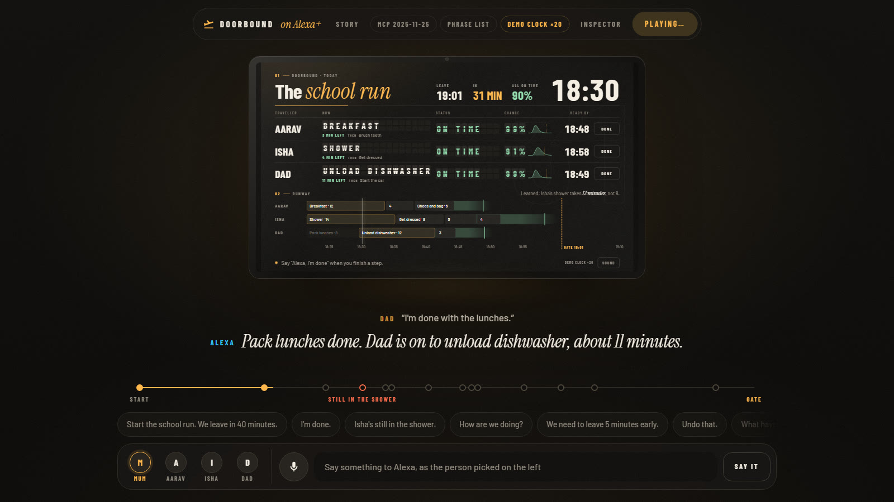

# Doorbound

**The household's morning, as a live departure board on Alexa+.** Who is doing what, each person's real chance of making the door on time, and a new plan the moment someone slips.



> "Alexa, start the school run. We leave in 36 minutes."
> "I'm done with breakfast."
> "Isha's still in the shower. Eight more minutes, she says."
> **Alexa:** "Re-routed: Isha has breakfast to go and Dad takes over pack bag for Isha. Everyone still leaves at 7:48, and Isha is now at 89%."

Built for the Build, Ship, Shape: Amazon Developer Hackathon, Alexa+ track. A self-hosted MCP server over Streamable HTTP (protocol 2025-11-25, and 2026-07-28 for clients that negotiate it), with an MCP App that is the board. Run it and open http://localhost:3939 for the story, or http://localhost:3939/sim to talk to it.

## The problem

Nearly every household has a daily departure: school, work, the bus. And people misjudge how long things take, even things they do every day. This is the planning fallacy: in Buehler, Griffin and Ross (1994), only about 30% of students finished by the time they had predicted. Five people's mornings make it worse, because one person's overrun lands on everyone else.

The usual tools are a timer per task or a checklist per person. Neither knows that Isha's eight-minute shower takes twelve, and neither can tell you, at 7:26 with a shower still running, whether the family will make 7:48, or what to change so it does.

## What it does

- **A board for the kitchen screen.** One row per person in split-flap letters: what they are doing, what is next, a status (ON TIME, TIGHT, DELAYED), their chance of being ready by the gate drawn as a live curve (the filled part is before the gate), and the time they will be ready by. Below, a runway: everyone's remaining steps laid out to the gate, with a soft tail showing how late it could realistically run.
- **It learns.** Every "I'm done" is a real duration. After a few mornings the plan uses what actually happens, not what was said ("Isha's shower takes *12 minutes*, not 8").
- **It re-plans within the household's rules.** When someone falls behind, it finds the gentlest set of changes the household allows: a quicker version (breakfast to go), someone else takes a step (Dad packs the bag), a step waits until after leaving (the dishwasher), or is skipped. Alexa says what changed; one word undoes it.
- **Anyone, from anywhere.** "I'm done." "She's still in the shower." "We need to leave ten minutes early." "How are we doing?" "What have you learned?" Each is one tool call.
- **On the Echo Show and beyond.** A small card inside the conversation, the full board on a tap, and the same board on a TV at `/board` (read-only). `/board#replay` plays the demo morning in the browser with no server state at all.




## The maths, in plain words

Everything the board and Alexa say comes from one model, in `src/core/stats.ts` and `src/core/departure.ts`.

1. **A step's length is a distribution, not a number.** Each person's step is log-normal: always positive, and it can run long but never negative. The stated time is a prior worth two mornings; each real morning pulls the estimate towards what happens. With stated time *s*, real durations *x₁…xₙ*, prior weight *k = 2* and prior spread *σ₀ = 0.35*:

   μ = (k·ln s + Σ ln xᵢ) / (k + n)  σ² = (k·(σ₀² + (ln s − μ)²) + Σ (ln xᵢ − μ)²) / (k + n)

   The gap between what someone says and what they do also widens the spread: a habitual underestimate is extra uncertainty.

2. **A step already under way** has used up some of its time. The time still to go is the remainder of a log-normal truncated at the time elapsed, in closed form: with *z = (ln e − μ)/σ*, E[T | T > e] = e^(μ+σ²/2) · Φ(σ − z) / Φ(−z). So a shower that is running long keeps a realistic remainder instead of "any second now".

3. **A person's whole remaining morning** is a sum of such steps. The sum is matched by one log-normal with the same mean *M* and variance *V* (Fenton–Wilkinson): σ² = ln(1 + V/M²), μ = ln M − σ²/2. That gives, in closed form, their **chance of being ready by the gate**, Φ((ln g − μ)/σ), and their **ready-by time at 85% confidence**, e^(μ + 1.036σ). The household's chance is the product (people taken as independent).

4. **The re-plan is exact.** It finds the cheapest set of changes (quicker version 1, handoff 2, waits until after 3, skipped 4; at most one per step, never the step in progress) after which everyone is ready by the gate with at least 85% confidence; among equally cheap plans, the one most likely to get the whole household out. It is an iterative-deepening search over the changes, where each change updates two numbers per person in O(1), with two pruning rules that never cut off a better plan. When nothing gets everyone there, a binary search finds the least lateness any plan can reach, then the cheapest plan that reaches it (so Dad's dishwasher can wait, freeing him to take Isha's bag). A search budget bounds the work, with a greedy plan past it.

The story page draws each of these from the real code as you scroll: the curve learning from five real mornings, the steps adding up, and the re-plan's search.


**How we know it is right** (all in `npm test`):

- The chance of making the gate matches **100,000 simulated mornings** to within 2 percentage points, mid-morning with a step half done.
- The truncated remainder's mean and spread match simulation to within 2% and 4%; the sum matches 200,000 simulated mornings to within 2 points.
- The re-plan equals the **brute-force optimum on 1,000 random mornings**, and holds its guarantees on 2,000 more: nobody on time is made late, only allowed changes are made, a step in progress is never touched, nothing is lost, the same input gives the same plan.
- With no news, the expected ready time only ever moves later.
- The normal CDF uses a fit with relative error under 1.2e-7 everywhere, so the far tail stays accurate.

## Measured

On a Windows 11 laptop, Node 24 (`tsx scripts/bench.ts`, and `tsx scripts/bench.ts load` against a running server):

| | p50 | p95 | worst |
|---|---|---|---|
| Re-plan, 2,000 random mornings (1-5 people) | 0.12 ms | 4.8 ms | 12.5 ms |
| Re-plan, a household at the limits (8 people × 15 steps, 1,200 candidate changes) | 76 ms | 93 ms | 99 ms |
| The board's work each second (3 people) | 4 µs | 8 µs | |
| Board poll under load: 300 screens + 30 speakers for 20 s | 0.8 ms | 2.9 ms | 70 ms |
| Tool call under the same load | 3.0 ms | 4.3 ms | 5.8 ms |
| Memory of one running server (one household) | about 80 MB | | |

Zero errors in the load test. Pushed to 2,000 screens, one process served about 1,800 requests a second (load generator on the same laptop) before latency rose, still with no errors. A household needs a few requests a second. An unchanged poll is answered with an empty 204; the board page is one 84 kB (gzipped) file with no external requests, and the story page, with the whole board inside it, is 174 kB.

## Run it

Needs Node 20 or later.

```bash
npm install
```

```bash
npm run demo
```

- http://localhost:3939 is **the story**: a scroll story of the problem, the maths and the re-plan, every curve computed in the page by the same core the server runs, with the live board on a wall-mounted Echo Show.
- http://localhost:3939/sim is **the Alexa+ simulator**: the Echo Show on the wall, the conversation as subtitles, speaker avatars and a mic, and a drawer with every MCP message. Press **Play the morning** for the scripted morning (about 90 seconds on a 20× demo clock), or talk to it. The demo resets to the same household on every start.
- http://localhost:3939/board is the board on its own, as a TV would show it.

For a real household, `npm start` (no demo clock, empty household: tell it your routines).



## Deploy it

An Alexa+ add-on talks to a self-hosted MCP server over Streamable HTTP, so Doorbound has to be reachable over HTTPS. With Docker, one command does it, certificate included:

```bash
DOMAIN=doorbound.example.com AUTH_TOKEN=$(openssl rand -hex 32) docker compose up -d
```

Then register `https://doorbound.example.com/mcp` as the add-on's MCP endpoint, with `AUTH_TOKEN` as its bearer token. [`compose.yaml`](compose.yaml) runs the server read-only, with every Linux capability dropped, no new privileges, a 256 MB memory cap and a volume for the household, behind Caddy, which fetches and renews the certificate. The [`Dockerfile`](Dockerfile) builds in one stage and ships only Node and `dist/` (the pages and the server bundled into one 0.9 MB file): no sources, no `node_modules`, no npm, running as the `node` user. One household is one container of about 80 MB, so households scale out side by side.

Without Docker, `npm start` behind any HTTPS proxy or tunnel, with these set:

| Variable | What it does |
|---|---|
| `HOST` | Address to listen on. Anything other than loopback requires the next two. |
| `AUTH_TOKEN` | Bearer token the add-on presents (32+ characters). |
| `ALLOWED_HOSTS` | Host names clients will use (DNS-rebinding protection). |
| `ALLOWED_ORIGINS` | Origins allowed to call `/mcp` from a browser, if any. |
| `SCREEN_KEY` | Key a TV presents to read the board: open `https://your-host/board#k=SCREEN_KEY` (the fragment never reaches a server log). |
| `TRUST_PROXY=1` | Behind a proxy: rate-limit by the forwarded address, send HSTS over HTTPS. |
| `DATA_DIR` | Where the household file and audit log live (default `data/`). |

The MCP endpoint is `/mcp`; the board is the resource `ui://doorbound/board.html`.

## Check it

```bash
npm test
```

50 tests: the statistics against simulation, the departure model, the re-planner (brute force and properties), learning, storage, the security guards, the speech of a whole morning through the real tools, and our 2 kB MCP Apps bridge against the official host-side `AppBridge`.

```bash
npm run smoke
```

Against a running server (18 checks): both protocol versions, every tool's schema, the MCP App resource, a morning with a re-route and undo, the HTTP edges (foreign Origin 403, 64 kB cap, hash-only CSP on the board and the story page). It passes against `node dist/server.mjs` started from outside the project, which is what the container runs.

```bash
npm run typecheck
```

On GitHub, CI runs all of this on every push (Node 22 and 24), then builds the Docker image, checks it refuses to start without a token, and runs the smoke test against the container running read-only with every capability dropped. Dependabot checks the dependencies weekly.

## How it is built

```
src/core/     the model: statistics, learning, the departure, the re-planner (pure functions, no I/O)
src/server/   the MCP server, tools, storage, audit log, HTTP guards
src/board/    the board (an MCP App), and its 2 kB bridge to the host
src/site/     the story page: scroll scenes drawn from the core, the board replaying inside
src/sim/      the Alexa+ simulator and the small router that stands in for Alexa's language model
scripts/      build (pages and the server bundle), smoke test, benchmark, screenshots, one-turn client
Dockerfile, compose.yaml   the container and the one-command HTTPS deployment
```

- **The server holds the clock and the state; screens hold nothing.** Every screen derives the board from the same core functions and the server's time, so an Echo Show and a TV agree to the second.
- **One tool per thing a household says**, each with an output schema, plain speakable text, and error results that say what to say instead (Amazon's add-on design guide).
- **The board is one self-contained HTML file** (fonts inlined), served with a hash-only Content Security Policy. It builds its DOM once and then changes only what moved: one transform per frame, text once a second.

## Design

- **From the object itself.** An airport departure board, read from across a kitchen: amber on warm black, split-flap letters, one row per traveller. A soft spotlight and film grain keep it from looking like a spreadsheet.
- **Two voices of type.** Bold condensed capitals for the facts, an italic serif for the one word that carries the feeling ("The *school run*", "*Re-routed.*", "takes *12 minutes*"), Barlow for everything else. All three under the SIL Open Font License.
- **Motion with a job.** Real split-flaps: the old top half falls, the new bottom half swings in and settles. A re-route is choreographed: an amber scan crosses the runway, the rows it touches light up, the handed-over step lifts out of one lane and arcs into another, the chance counts up. A change of standing sweeps the row in its new colour. Words arrive one by one (blur to sharp, 60 ms apart, expo-out). Nothing loops for decoration, and reduced motion turns it all off.
- **A story, not a brochure.** The page at `/` is a scroll story in the genre of cinematic product sites: pinned stages, one idea per beat, a progress hairline and a numbered rail, one hard colour block, a giant outlined wordmark. Its hero object is the product itself, replaying live on a wall-mounted Echo Show, and every chart in it is the real model, not an illustration.
- **Calm by default.** Sound (a flap clatter, a chime on a re-route) is off until someone switches it on. The minutes left sit behind everything as a faint outline, not a flashing countdown.
- **Readable by everyone.** Text contrast at least 4.5:1 (3:1 for large labels), measured; real buttons with focus rings and names that say whose step they mark; a screen-reader sentence per row and spoken updates; nothing told by colour alone.

## Security

The server refuses to start beyond loopback without a token and a host allow-list, compares tokens in constant time, rate-limits every client, validates every input and the file on disk, caps bodies at 64 kB, keeps an append-only audit log, and serves pages under a hash-only CSP. [SECURITY.md](SECURITY.md) walks a 19-point checklist item by item against the code.

## Limits, honestly

- People's mornings are treated as independent. A shared delay (everyone overslept) is not modelled.
- Fenton–Wilkinson is an approximation; the tests bound its error, they do not make it exact.
- It learns from the last nine mornings per person and step; one strange morning moves it, a few correct it.
- The simulator's router is a small rule set standing in for Alexa+'s language model, which in Alexa+ reads the tool descriptions itself.
- Tested in browsers and the simulator, not on an Echo Show (we have no Amazon devices).
- The board is designed for households of up to eight.
- The Docker image and compose file have not been built here (no Docker on the development machine); the bundle they run is tested directly. Memory was measured on Windows.

## License

MIT. See [LICENSE](LICENSE).
