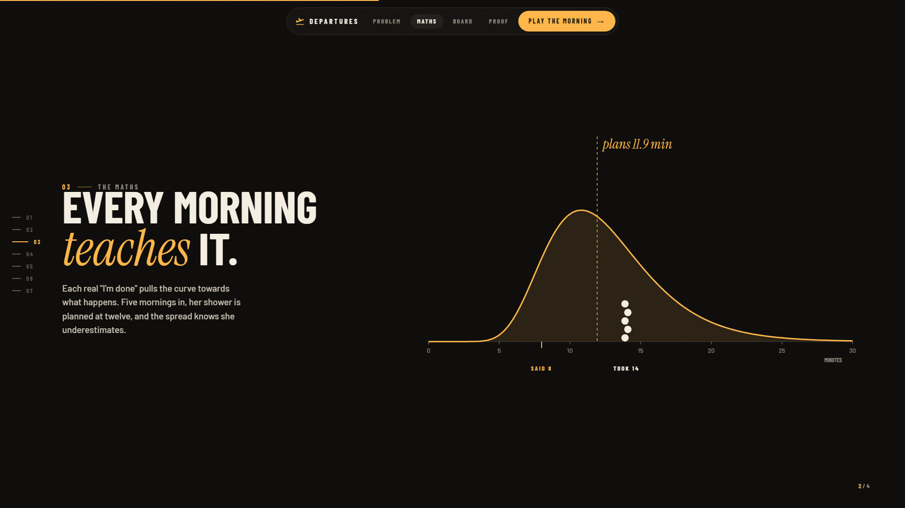

# The maths behind Doorbound

The demo household (Aarav, Isha, Dad) and its "learned" history are illustrative, not measured; the board says so in its replay.

Everything the board and Alexa say comes from one model, in `src/core/stats.ts`, `src/core/pace.ts` and `src/core/departure.ts`.

1. **A step's length is a distribution, not a number.** Each person's step is log-normal: always positive, and it can run long but never negative. The stated time is a prior worth two mornings; each real morning pulls the estimate towards what happens. With stated time *s*, real durations *x₁…xₙ*, prior weight *k = 2* and prior spread *σ₀ = 0.35*:

   μ = (k·ln s + Σ ln xᵢ) / (k + n)  σ² = (k·(σ₀² + (ln s − μ)²) + Σ (ln xᵢ − μ)²) / (k + n)

   The gap between what someone says and what they do also widens the spread: a habitual underestimate is extra uncertainty.

2. **A step already under way** has used up some of its time. The time still to go is the remainder of a log-normal truncated at the time elapsed, in closed form: with *z = (ln e − μ)/σ*, E[T | T > e] = e^(μ+σ²/2) · Φ(σ − z) / Φ(−z). So a shower that is running long keeps a realistic remainder instead of "any second now".

3. **A person's whole remaining morning** is a sum of such steps. The sum is matched by one log-normal with the same mean *M* and variance *V* (Fenton–Wilkinson): σ² = ln(1 + V/M²), μ = ln M − σ²/2. That gives, in closed form, their **chance of being ready by the gate**, Φ((ln g − μ)/σ), and their **ready-by time at 85% confidence**, e^(μ + 1.036σ). The household's chance is the product (different people taken as independent).

4. **A slow morning is slow all the way through.** One person's steps share today's pace: ln Xⱼ = μⱼ + σⱼ(√ρ·Z + √(1−ρ)·Eⱼ), with Z the pace and ρ how strongly a household's steps move together. Every finished step is a reading of Z, and Z's posterior stays normal (conjugate); a step still running is censored evidence ("longer than 12 minutes so far"), folded in with the exact mean and variance of the skew-normal it gives. The steps still to come shift by σⱼ√ρ·E[Z] and share the uncertainty ρ·Var[Z] that is left, which widens their sum: Cov(Xᵢ, Xⱼ) = E[Xᵢ]E[Xⱼ](e^(ρ·Var[Z]·σᵢσⱼ) − 1). That double sum is kept as running power sums, Σₖ cᵏ/k!·(Aₖ² − Bₖ), so the re-planner can still try a change in O(1). ρ is learned from pairs of steps finished in the same morning (their standardised readings have E[rᵢrⱼ] = ρ), starting from 0.3. Ignore all this and a planner says 85% and delivers less; the board shows the pace as SLOW TODAY +20%. Households can share a pace as well: Z_p = √κ·W + √(1−κ)·U_p, with κ learned from pairs of different people's readings (E[r_p r_q] = ρκ) starting from 0, and all the paces solved together (exact for finished steps, one moment match per running step). The household's chance stays the product of each person's, a lower bound when mornings are linked (Harris–FKG).

5. **The re-plan is exact.** It finds the cheapest set of changes (quicker version 1, handoff 2, waits until after 3, skipped 4; at most one per step, never the step in progress) after which everyone is ready by the gate with at least 85% confidence; among equally cheap plans, the one most likely to get the whole household out. It is an iterative-deepening search over the changes, where each change updates the running sums of at most two people in O(1), with two pruning rules that never cut off a better plan. When nothing gets everyone there, a binary search finds the least lateness any plan can reach, then the cheapest plan that reaches it (so Dad's dishwasher can wait, freeing him to take Isha's bag). A search budget bounds the work, with a greedy plan past it.

6. **One bathroom.** A step can need a shared space. Whoever is in it and whoever is queuing is tracked live: first come, first in; the next is let in when it frees, and their step's clock starts then, so waiting is never learned as showering. Waits further ahead are anticipated: a later user waits W = max(0, F − A) for the space, free at F, having arrived at A. With F and A taken as independent normals, W's mean and variance are Clark's closed forms, and its covariance with the arrival is −Var(A)·P(W > 0) (Stein's lemma), so a late arrival waits less and the lane's spread stays right. On 20,000 simulated mornings the chances are calibrated before the queue forms (1.4%; 28% without anticipating it) and during it (0.7%).

7. **What a household is like.** Three things are learned from its own mornings, each starting from "nothing assumed": how much a weekday slows everyone (a prior mean for the pace Z, from that weekday's readings over √ρ); the household's own planning fallacy (the mean log ratio of real to stated times across all its steps, leave-one-out so a step's own mornings are not counted twice, shrunk by ten mornings), applied to every stated time so steps with few mornings are corrected too; and how strongly its people's mornings move together (κ).

8. **A learned time is itself uncertain.** With real mornings, a step's spread is the predictive one: divided by n − 1, plus 1/(k + n) for the uncertainty of its centre. Planning with the plug-in spread made a young model overconfident (85% meant about 81% after five mornings).

The story page draws each of these from the real code as you scroll: the curve learning from five real mornings, the steps adding up, and the re-plan's search.

**How we know it is right** (all in `npm test`):

- **Not only against itself.** The checks below draw mornings from the model; `robust.test.ts` draws them from processes that break its assumptions, with each household learning from five past mornings (30 households x 500 mornings each when measured; a smaller run in the test). Calibration error, and what happened when it said 80-90%: mornings that follow the model 1.5% (84%); 8% of steps taking 1.5 to 3 times as long 3.1% (77%); gamma-shaped steps 2.1% (82%); people who say 60% of the truth 1.1% (84%); 5% of "done"s said 20 minutes late 6.7% (90%: cautious, the safe side). Two fixes came out of it: plan with the predictive spread (a learned time is itself uncertain after five mornings; without this, 85% meant about 81%), and learn the household's own planning fallacy across all its steps (for people who underestimate, the error fell from 6.5% to 1.1%). Heavy tails remain the weakest case: at 85% they deliver about 77%, which the kept score shows a household on its own mornings.

- **Calibrated:** on 40,000 simulated mornings with a shared daily pace, looked at a random moment (usually mid-step), when it says 80–90% it happens **84.9%** of the time. Its calibration error is **0.39%**, as low as the log-normal sum allows (0.37% when steps really are independent); the same model with steps taken as independent is off by 2.44%.
- The pace posterior and the censored update match numerical integration to 1e-5; the running sums match the exact covariance to 1e-4. The household pace matches 2-D integration, equals the per-person pace exactly when κ = 0, and on 12,000 three-person mornings with shared slow days lowers the Brier score (0.1278 against 0.1309).
- Kept score over 2,000 simulated mornings, its live forecasts land within 2.5 points of what happened in every band. Plan-tomorrow gives the most sleep of any plan with the same chance (brute force).
- The chance of making the gate matches **100,000 simulated mornings** to within 2 percentage points, mid-morning with a step half done.
- The truncated remainder's mean and spread match simulation to within 2% and 4%; the sum matches 200,000 simulated mornings to within 2 points.
- The re-plan equals the **brute-force optimum on 1,000 random mornings**, and holds its guarantees on 2,000 more: nobody on time is made late, only allowed changes are made, a step in progress is never touched, nothing is lost, the same input gives the same plan.
- With no news, the expected ready time only ever moves later.
- The normal CDF uses a fit with relative error under 1.2e-7 everywhere, so the far tail stays accurate.

Back to the [README](../README.md).
